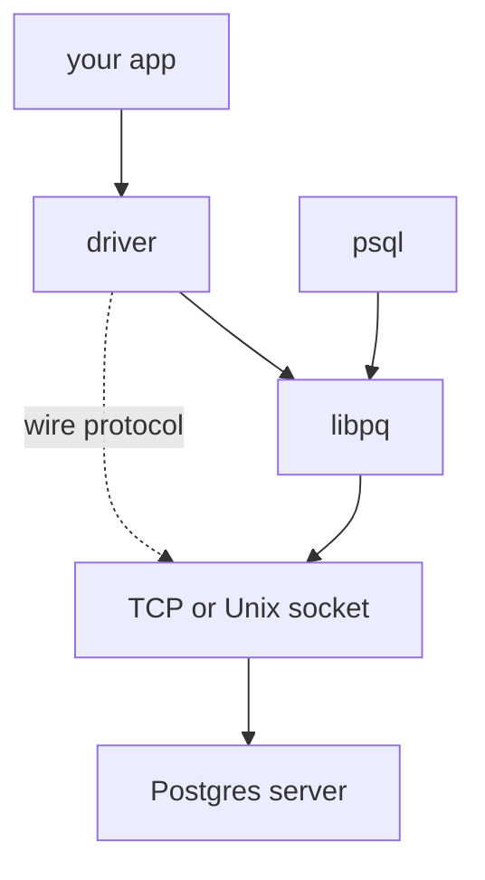
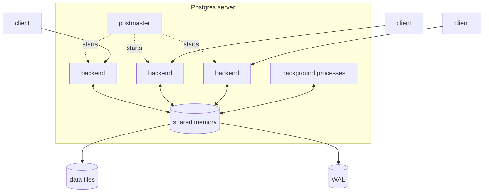
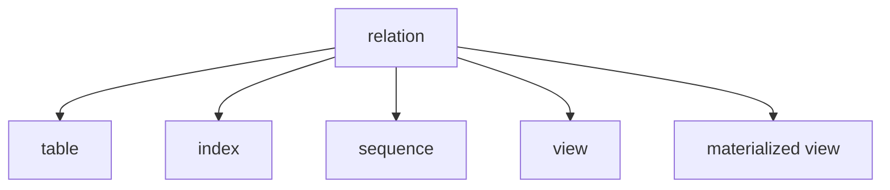

Postgres is big. Before going into any detail, let's look at the whole picture.

By the end of this article, you'll be able to follow one query from the moment a client sends it to the moment Postgres answers.

## A client and a server

Postgres has a client-server architecture. Your application is the client. Postgres is the server. They talk over a TCP connection, or over a Unix socket when both run on the same machine.

## The client

On the client side, you use a driver such as `pg` in Node.js.

Some drivers are built on top of libpq, the C library that ships with Postgres. libpq knows how to open a connection, authenticate, send queries, and read the results. Other drivers skip it and speak the Postgres wire protocol themselves.

`psql`, the command line tool you probably used to connect to a database for the first time, is itself a client built on libpq.



## The server

The server is where everything happens.

Postgres runs as many processes on one machine. A process is a program running on your computer, like VS Code or your browser.

A main process, the postmaster, starts a new process for every client that connects. Other processes run in the background, writing data to disk and cleaning up after queries.

All these processes share one area of memory. Most of it is a cache of pages, the fixed-size blocks Postgres uses to store your data.

Every change is also written to a log, the WAL. Postgres uses it to recover after a crash and to copy data to other servers.



## Relations

Postgres calls tables relations. Indexes, sequences, views, and materialized views are relations too.



- A table stores your rows.
- An index is a separate structure that points to rows in a table, so Postgres can find them without reading the whole table.
- A sequence is a counter that hands out the next number, often used for IDs.
- A view is a saved query. It stores no data and runs the query every time you read from it.
- A materialized view is a saved query whose result is stored on disk. It only changes when you refresh it.

For example, an index on `users.email` keeps the emails sorted, and each one points to where its row lives in the table, as a page number and a position inside that page:

```
users_email_idx         users (table)
---------------         -------------
ann@mail.com  -> (0,3)  page 0, row 3
bob@mail.com  -> (0,1)  page 0, row 1
eve@mail.com  -> (1,2)  page 1, row 2
```

In the relational model, a relation is the table itself. Foreign keys are what link tables together.

We'll go through each of these parts in detail in the rest of this article.
