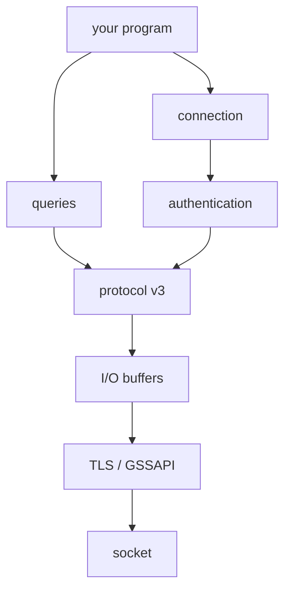
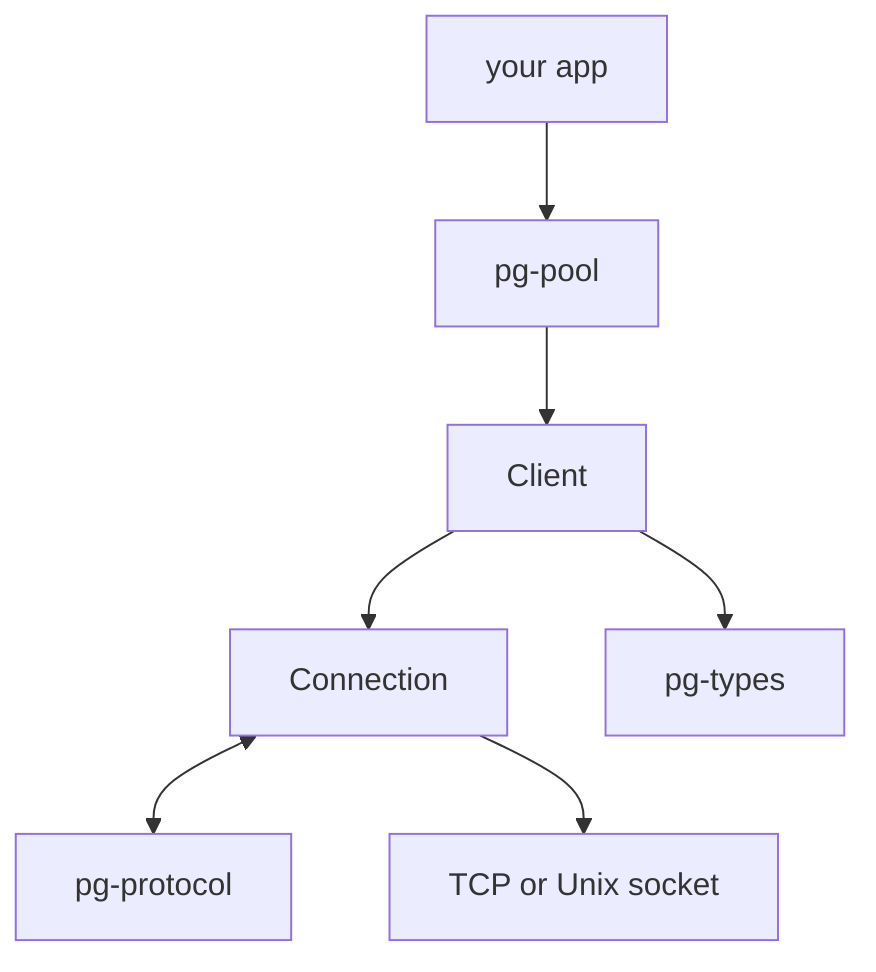

Every query starts on the client. Before Postgres can do anything, something has to open a connection, prove who you are, and send your SQL in a format the server understands.

## libpq

libpq is the C library that ships with Postgres for exactly that. Its source lives in `src/interfaces/libpq` in the Postgres repository. `psql`, `pg_dump`, and many drivers all use it to talk to the server.

The code is split into a few layers, one or a few files each:

- Connection (`fe-connect.c`) reads your connection settings, finds the server, opens the socket, and goes through the startup handshake.
- Authentication (`fe-auth.c`, `fe-auth-scram.c`, `fe-auth-oauth.c`) answers the server when it asks for a password, a SCRAM exchange, Kerberos, or an OAuth token.
- Encryption (`fe-secure.c`, `fe-secure-openssl.c`, `fe-secure-gssapi.c`) wraps the connection in TLS or GSSAPI encryption.
- Protocol (`fe-protocol3.c`) turns everything into messages of the Postgres wire protocol, version 3, and parses the messages that come back.
- Queries (`fe-exec.c`) sends queries and builds the results you read.
- I/O (`fe-misc.c`) buffers bytes in and out of a non-blocking socket, so your program is never stuck waiting unless it asks to be.



Here is the smallest useful program with libpq:

```c
PGconn *conn = PQconnectdb("postgresql://localhost/app");
PGresult *res = PQexec(conn, "SELECT now()");

printf("%s\n", PQgetvalue(res, 0, 0));

PQclear(res);
PQfinish(conn);
```

Beyond that, libpq can send parameters separately from the SQL so values never end up in the query text, run queries asynchronously or in a pipeline, stream large results, and copy data in bulk with `COPY`.

You won't need most of it day to day. But in the Postgres world we tend to forget about the client, so at least you now have a broader picture of what it can do.

## psql

`psql` is the command line tool that comes with Postgres. You type SQL, it sends it through libpq, and it prints the result as a table.

On top of SQL, it has its own commands that start with a backslash, like `\d users` to describe a table or `\timing` to see how long each query took.

## Unix sockets and TCP

The client and the server exchange bytes through a socket. There are two kinds.

A Unix socket is for when the client and the server run on the same machine. It shows up as a file, by default `/tmp/.s.PGSQL.5432`, and both processes connect to that path. The data never touches the disk or the network. The kernel copies it straight from one process to the other. Postgres can also ask the kernel which OS user is on the other side, which lets you log in without a password with `peer` authentication.

TCP uses the same interface. libpq opens the socket, connects, then reads and writes bytes the exact same way. Only the address changes: a host and a port instead of a file path. Postgres listens on port 5432 by default.

What changes is what happens underneath. The network only moves packets, and packets get lost, duplicated, or arrive out of order. TCP sits on top and gives you a reliable stream of bytes. It numbers what it sends, waits for the other side to confirm, and sends again what never arrived. It also slows the sender down when the receiver can't keep up, which is a form of backpressure. All that work is why a Unix socket is faster when both sides are on the same machine.

## Drivers

A driver is the library your application uses to talk to Postgres in its own language. It does the same job as libpq: open the socket, authenticate, send queries in the wire protocol, and turn the bytes that come back into values your language understands, like numbers, strings, and dates.

Some drivers wrap libpq. Most modern ones skip it and implement the wire protocol themselves, so they don't need a C library installed next to them.

In Node.js, the most used driver is `pg`, also called node-postgres. In Rust, it's `tokio-postgres`, with `postgres` as its blocking version, both written in pure Rust. Drizzle, the TypeScript ORM, has also started shipping its own Postgres driver: it was a preview in the 1.0 release candidates and now comes bundled in `drizzle-orm/postgres`.

### Inside pg

`pg` is split into small packages, each doing one thing:

- `pg-connection-string` parses a URL like `postgresql://user@localhost/app` into connection settings.
- `pg-protocol` encodes your queries into wire protocol messages and parses the messages the server sends back. It works on raw bytes and knows nothing about sockets.
- `pg` itself holds the `Connection`, which owns a Node.js socket and passes bytes through `pg-protocol`, and the `Client`, which you use to connect, authenticate, and run queries.
- `pg-types` converts each column from the text Postgres sends into a JavaScript value, based on the column's type. That's how an `int4` becomes a `number` and a `timestamptz` becomes a `Date`.
- `pg-pool` keeps a set of open clients and lends one to each query, up to 10 by default, so you don't pay for a new connection every time.



A `Client` is one connection, so one backend process on the server. By default it runs one query at a time, and if you send more, it queues them and sends the next one when the previous answer comes back. That's why you use a pool as soon as your app handles more than one request at a time.

There is also `pg-native`, which swaps the pure JavaScript connection for libpq through native bindings, if you'd rather have libpq do the work underneath.
