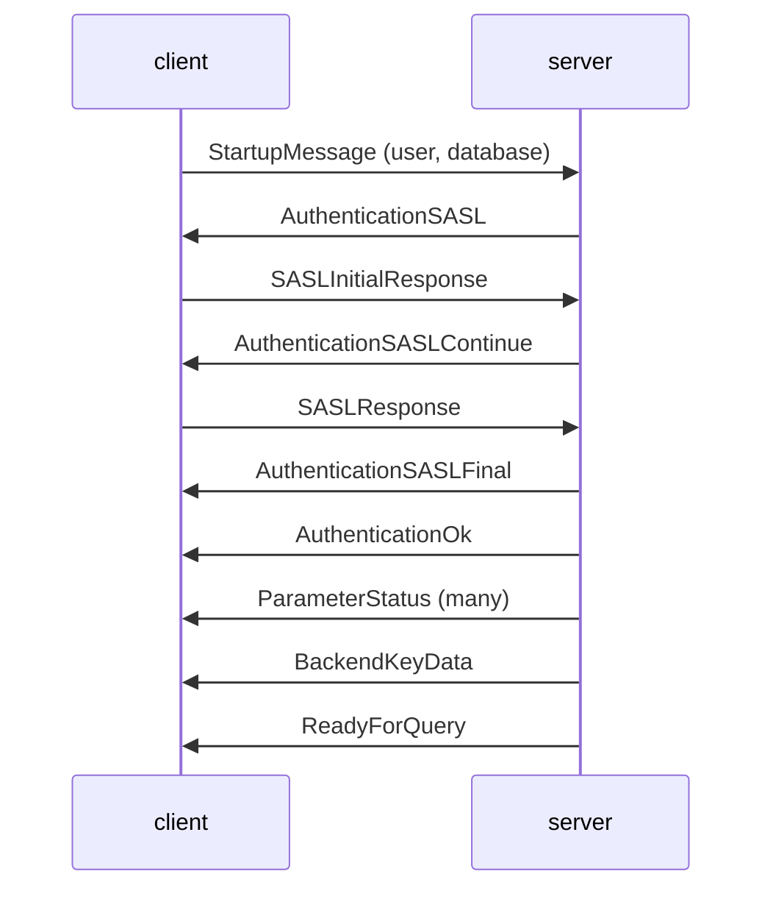
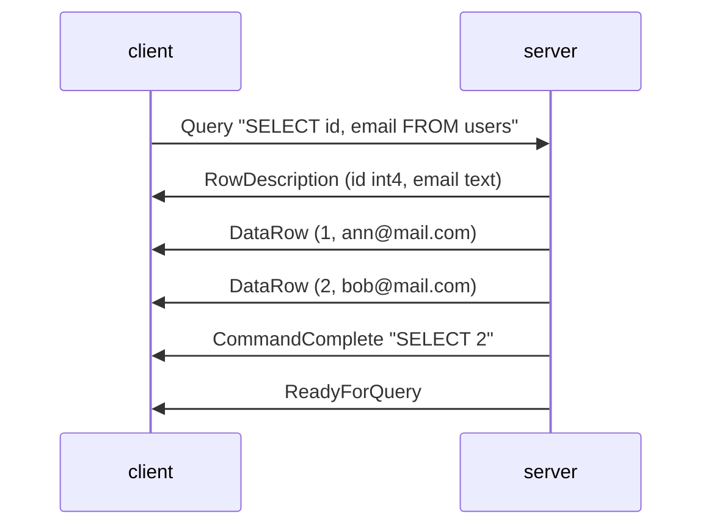
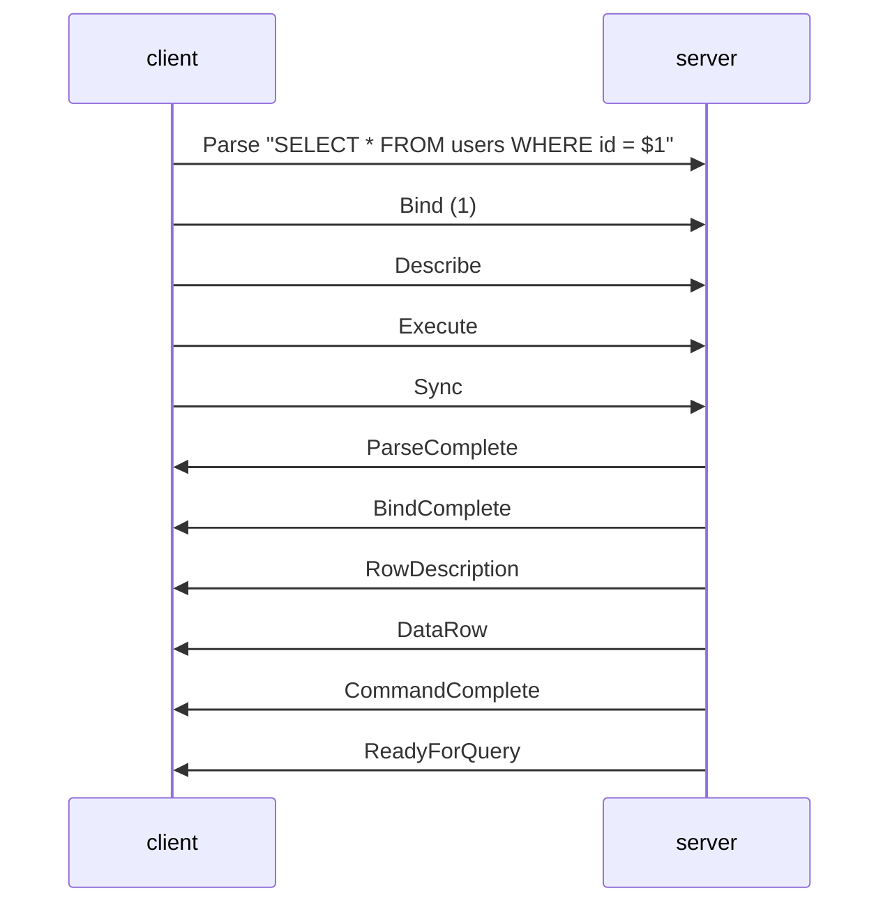

libpq, `pg`, `tokio-postgres`, and the Drizzle driver all speak the same language with the server: the Postgres wire protocol, version 3. It has been the same since Postgres 7.4 in 2003, with small additions in 3.2 for Postgres 18.

The protocol is a conversation of messages. The client sends one, the server answers with one or more, and so on until the connection closes.

## A message

Almost every message has the same shape:

- one byte for the type, like `Q` for a query or `Z` for "ready for the next query",
- four bytes for the length of the rest of the message, including these four bytes,
- the content.

Here is the client sending `SELECT 1`:

```
Q            type: Query
00 00 00 0d  length: 13 bytes
SELECT 1\0   the SQL, ending with a zero byte
```

The length is what lets the other side know where a message ends and the next one starts, since TCP only gives it a stream of bytes.

## Opening a connection

The first message is the only one without a type byte. The client sends a startup message with the protocol version and a few settings, like the user and the database.

The server answers with an authentication request. With the default `scram-sha-256` method, the client and the server exchange a few messages to prove the client knows the password without ever sending it.

Once that's done, the server sends `AuthenticationOk`, then a list of its settings (`ParameterStatus`), a key to cancel queries later (`BackendKeyData`), and finally `ReadyForQuery`.



If the client wants TLS, it first sends an `SSLRequest`, and the server answers with a single byte, `S` for yes or `N` for no. Everything after that is encrypted.

## A simple query

The simple query protocol is one message, `Query`, with the SQL as text.

The server answers with a `RowDescription` (the name and type of each column), one `DataRow` per row, a `CommandComplete` with a tag like `SELECT 3`, and `ReadyForQuery`.



`ReadyForQuery` also carries the state of the transaction: `I` when idle, `T` inside a transaction, and `E` inside a transaction that failed.

## An extended query

When you pass parameters, drivers use the extended query protocol. It splits the work into steps:

- `Parse` sends the SQL with placeholders like `$1`, and the server prepares it.
- `Bind` sends the values for the placeholders.
- `Describe` asks for the shape of the result.
- `Execute` runs it.
- `Sync` closes the batch.



The client sends all five messages at once and doesn't wait between them. And since the values travel in their own message, they are never mixed with the SQL, which is why parameters protect you from SQL injection.

A named statement can be parsed once and then bound and executed many times, which is what a prepared statement is.

## Errors

When something fails, the server sends an `ErrorResponse` instead of the rest of the answer. It holds several fields: a severity, a code like `23505` for a unique violation, a message, and sometimes a detail or a hint.

In the extended protocol, the server then skips every message until the next `Sync`, and answers with `ReadyForQuery`. That's how the client and the server get back in step after an error.

## Canceling a query

A backend runs one query at a time and only reads the next message once the current query is done, so the client can't stop a query by sending something on the same connection.

To cancel, the client opens a second connection and sends a `CancelRequest` with the process ID and the secret key it received in `BackendKeyData`. The server finds that backend and tells it to stop. The answer to the original query then comes back as an error on the first connection.
