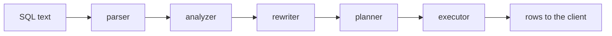

A backend receives your SQL as plain text. Before it can return a single row, it has to understand that text, check it against your tables, decide how to run it, and then run it.

In the source, that whole journey starts in one function, `exec_simple_query` in `src/backend/tcop/postgres.c`, and goes through five stages:



## Parser

The parser turns the text into a tree. It only checks the grammar: is this valid SQL? It doesn't know yet whether your tables exist.

It's generated from two files, `scan.l`, which splits the text into tokens like keywords, names, and numbers, and `gram.y`, the grammar of Postgres SQL. Tools called Flex and Bison turn these files into C code when Postgres is built.

So `SELECT email FROM users WHERE id = 1` becomes a tree that says: a select, with one column called `email`, from something called `users`, with a condition comparing `id` to the number `1`.

## Analyzer

The analyzer gives the tree a meaning. It looks up `users` in the system catalogs, the tables where Postgres keeps track of every table, column, type, and function. It checks that `email` and `id` exist, finds their types, and picks the right `=` operator for them.

If you made a typo in a column name, this is where you get the error.

The result is a query tree, where every name has been replaced by a reference to the real object.

## Rewriter

The rewriter takes the query tree and changes it before anyone plans it. It does three main things.

The first is views. A view stores no data. Postgres only keeps its query, as a rule saying "when someone reads this view, read this query instead". So say you create this view.

```sql
CREATE VIEW active_users AS
SELECT * FROM users WHERE deleted_at IS NULL;
```

And then run `SELECT email FROM active_users`, the rewriter replaces `active_users` with its query. What the planner gets is the same as if you had written this yourself.

```sql
SELECT email FROM (
  SELECT * FROM users WHERE deleted_at IS NULL
) AS active_users;
```

The second is writes through a view. If a view is simple enough, like the one above, you can run an `INSERT` or `UPDATE` on it, and the rewriter turns it into the same change on `users`.

The third is row-level security. If a table has policies, like "users can only see their own rows", the rewriter adds their conditions to the query, so the rows you're not allowed to see are filtered out like any other `WHERE`.

After this step, views don't exist anymore. The planner only sees tables and conditions.

## Planner

The planner decides how to run the query. There are usually many ways to get the same result: read the whole table or use an index, join `users` to `orders` or `orders` to `users`, join them with a hash table, a sort, or a loop.

For each option, it estimates a cost, mostly the number of pages to read. Reading pages in order is cheap, and jumping around is more expensive, four times by default. To guess how many rows each step returns, it uses statistics about every column, which `ANALYZE` and autovacuum collect.

It then keeps the cheapest plan. With many tables to join, there are too many orders to try them all, so from 12 tables onwards it switches to a [genetic algorithm](https://en.wikipedia.org/wiki/Genetic_algorithm) that looks for a good order instead of the best one. We won't go into how it works here.

You can see the plan it picked with `EXPLAIN`:

```sql
EXPLAIN (COSTS OFF)
SELECT * FROM users WHERE email = 'ann@mail.com';
```

```
Index Scan using users_email_idx on users
  Index Cond: (email = 'ann@mail.com'::text)
```

Planning takes time, so for a prepared statement, Postgres keeps the plan in a cache. The first five runs get a plan made for their exact values. After that, Postgres builds a generic plan that works for any value, and switches to it if it's cheaper than those five on average, counting the time they spent planning.

## Executor

The executor runs the plan. A plan is a tree of nodes: scans at the bottom read the tables, and nodes above them join, filter, sort, or count.

```sql
EXPLAIN (COSTS OFF)
SELECT u.email, o.total
FROM users u JOIN orders o ON o.user_id = u.id;
```

```
Hash Join
  Hash Cond: (o.user_id = u.id)
  ->  Seq Scan on orders o
  ->  Hash
        ->  Seq Scan on users u
```

Each node works on demand. When the top node needs a row, it asks its children, which ask theirs, down to the scans. Rows flow up one at a time, so Postgres can send the first rows to the client before it has read the whole table, and a `LIMIT 10` stops everything after ten rows.

Every row that reaches the top is sent to the client as a `DataRow` message, the one from the wire protocol.

For an `INSERT`, `UPDATE`, or `DELETE`, the top node is a `ModifyTable` node. It takes the rows from below and changes the table instead of sending them.

When a table is big, the planner can add a `Gather` node to the plan. The executor then starts parallel workers, each scanning part of the table, and the `Gather` node collects their rows.

## Back to the client

Once the executor is done, the backend sends `CommandComplete` and `ReadyForQuery`, and waits for the next message.

Every step we've skipped so far happens inside the executor: reading pages from shared memory or from disk, deciding which version of a row you can see, and writing the change to the WAL. That's what the next parts are about.
