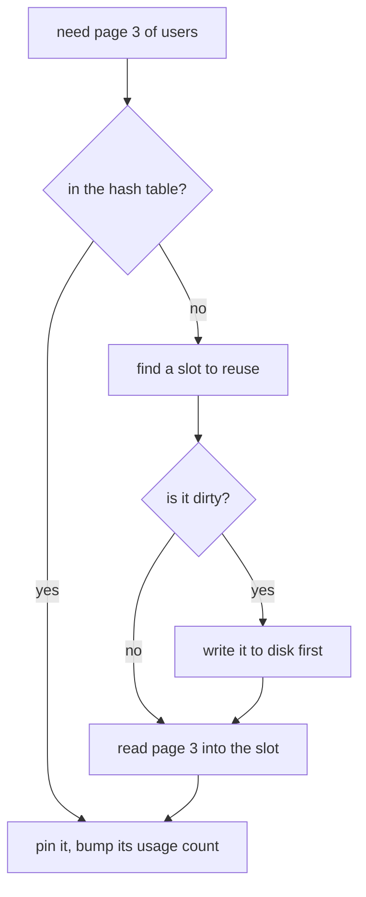

Reading from disk is slow, so Postgres keeps the pages it uses in memory. That cache is called shared buffers, and it lives in the shared memory every process can see.

A backend almost never reads a table file directly. When the executor needs a page, it asks the buffer manager, the code in `src/backend/storage/buffer`, and gets back a page in shared buffers.

## What's inside

Shared buffers is a big array of 8 KB slots, one page per slot. Its size is set by `shared_buffers`, 128 MB by default, so 16,384 pages. It's allocated once when the server starts, which is why changing it needs a restart.

Next to the array, each slot has a small descriptor with what Postgres needs to manage it.

- Which page it holds, as a tag made of the relation, the fork, and the page number.
- How many processes are using it right now, called pins.
- A usage count, from 0 to 5, that goes up every time someone uses the page.
- A few flags, like whether the page was modified since it was read, which makes it dirty.

To find a page quickly, Postgres also keeps a hash table from tags to slots. It's split into 128 partitions, each with its own lock, so backends looking up different pages don't wait for each other.

## Reading a page

When a backend needs page 3 of `users`, the buffer manager does this.



While a page is pinned, no one can evict it. The backend reads or changes it, holding a lock on the page content for the time it takes, then unpins it.

## Choosing which page to evict

When there's no room, Postgres needs to pick a page to throw away. It uses an algorithm called clock sweep.

Picture the slots on a clock, with a hand pointing to one of them. To find a victim, the hand moves forward slot by slot.

- If the page is pinned, it skips it.
- If its usage count is above 0, it lowers it by one and moves on.
- If its usage count is 0, that's the one.

Move the hand one slot at a time. Between moves, let a query read a page: it bumps that page's count, which helps it survive the next turn.

<div data-clock-sweep></div>

A page used often keeps getting its count bumped back up, so it survives several turns of the hand. A page read once and never again drops to 0 quickly and gets reused. It's a cheap approximation of "evict the least recently used page", without keeping a sorted list that every read would have to update.

## Dirty pages

When a backend changes a row, it only changes the page in memory and marks it dirty. The change is safe because it's already in the WAL. Before a dirty page can go to disk, Postgres makes sure the WAL describing its last change is on disk first, using the WAL position stored in the page header.

Three processes can write dirty pages.

- The checkpointer writes all of them at regular intervals.
- The background writer writes some ahead of time, in the slots the clock hand is about to reach.
- A backend writes one itself when the slot it picked is dirty, which is what the other two try to avoid, since it makes your query wait.

## Big scans

A full scan of a huge table could fill shared buffers with pages that will never be read again and push out everything useful.

So when a sequential scan reads a table bigger than a quarter of shared buffers, Postgres gives it a small ring of slots instead, starting at 256 KB, and the scan keeps reusing the same slots. Vacuum and bulk writes like `COPY` get their own rings too.

## Two caches

Postgres reads files through the operating system, and the operating system has its own cache of file pages. So a page can be in memory twice, once in shared buffers and once in the OS cache.

That's why `shared_buffers` is usually set to about a quarter of the machine's memory, not all of it. The rest is left to the OS cache, which still catches most reads that miss shared buffers. When the planner estimates costs, `effective_cache_size` tells it how much of both caches it can count on.

## Seeing it

The `pg_buffercache` extension shows what's in shared buffers right now.

```sql
CREATE EXTENSION pg_buffercache;

SELECT c.relname, count(*) AS pages
FROM pg_buffercache b
JOIN pg_class c ON b.relfilenode = pg_relation_filenode(c.oid)
GROUP BY c.relname
ORDER BY pages DESC
LIMIT 5;
```

It tells you which tables and indexes are taking the most room in memory, and with its `usagecount` and `isdirty` columns, how hot and how dirty they are.
