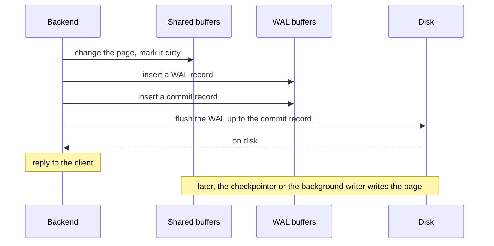
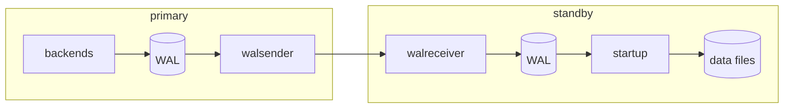

When you commit, Postgres tells you your data is safe. If the power goes out one second later, it's still there.

You'd think that means Postgres writes the changed pages to disk before answering. It doesn't. The pages stay in shared buffers, dirty, sometimes for minutes. What goes to disk at commit is a short description of the change, in the WAL, the write-ahead log.

## Why a log

Writing the pages at every commit would be slow. One small transaction can touch a table page, a few index pages, the free space map, all in different files and different places on disk. And a page is 8 KB, even when you changed 10 bytes of it.

The WAL is one stream of records, written one after the other at the end of a file. Appending is the fastest thing a disk can do. At commit, Postgres only needs to make sure the records of that transaction reached the disk.

If the server crashes, the pages in memory are lost, but every change is in the WAL. On restart, Postgres reads it and applies the changes again.

That only works with one rule, the one that gives the WAL its name. A change has to be in the WAL on disk before the page it changed can be written. We saw it in the shared buffers part, with the WAL position stored in every page header.

## Records

Every change becomes a WAL record. Inserting a row, splitting an index page, committing a transaction, each one writes a record.

A record starts with a small header. It has its total length, the transaction ID, the position of the previous record, a checksum, and a resource manager. The resource manager says which part of Postgres wrote it, like the heap, the B-tree, or transactions, and knows how to replay it. After the header come the pages the record touches and the data needed to redo the change.

`pg_waldump` prints them.

```
rmgr: Heap        len (rec/tot):     59/    59, tx:        812, lsn: 0/0151D1A8, prev 0/0151D170, desc: INSERT off: 3, flags: 0x00, blkref #0: rel 1663/16384/16390 blk 0
rmgr: Btree       len (rec/tot):     64/    64, tx:        812, lsn: 0/0151D1E8, prev 0/0151D1A8, desc: INSERT_LEAF off: 2, blkref #0: rel 1663/16384/16393 blk 1
rmgr: Transaction len (rec/tot):     34/    34, tx:        812, lsn: 0/0151D228, prev 0/0151D1E8, desc: COMMIT 2026-11-22 10:14:03.118204 UTC
```

One `INSERT` gives three records. The row goes into page 0 of the table, its key into page 1 of an index, then the commit.

## LSN

Each record has a position in the WAL, its LSN, for log sequence number. It's the byte offset since the start of the WAL, printed as two halves in hexadecimal, like `0/0151D1A8`.

```sql
SELECT pg_current_wal_lsn();
-- 0/0151D228
```

LSNs only grow, so they work like a clock. The page header stores the LSN of the last record that changed the page. Replicas report the LSN they've replayed. Backups start and stop at an LSN.

On disk, the WAL is cut into files of 16 MB in `pg_wal/`, called segments. Their names, like `000000010000000000000001`, are just the LSN range they cover, after a timeline number.

## Commit

Here is what happens when a transaction changes a row and commits.



The records first go to the WAL buffers, a small area of shared memory. By default they take 1/32 of `shared_buffers`, up to one segment, so 4 MB with the default 128 MB.

At commit, the backend writes the WAL buffers up to its commit record and calls `fsync`, which waits until the disk confirms. That flush is the only disk write a commit waits for.

When many clients commit at the same time, one flush covers all of them. A backend that arrives while another is flushing waits, then finds its own commit record was written by the other's flush. That's group commit, and it's why Postgres handles thousands of commits per second on a disk that does far fewer flushes.

The walwriter also flushes the WAL buffers in the background every 200 ms, so they don't fill up between commits.

If you can afford to lose the last few transactions in a crash, `synchronous_commit = off` lets the backend answer before the flush. The walwriter writes it a moment later. A crash can lose the last fraction of a second of commits, but never leaves the database inconsistent.

## Checkpoints

The WAL can't grow forever, and replaying a week of it after a crash would take a long time.

So every 5 minutes, or sooner if 1 GB of WAL has piled up, the checkpointer runs a checkpoint. It writes every dirty page in shared buffers to disk, and spreads the writes over 90% of the time until the next one, to avoid a burst of I/O. When it's done, it records where it started, the redo point, in a small file called `pg_control`.

Every change before the redo point is now in the data files, so the WAL before it isn't needed for recovery anymore. Postgres recycles those segments.

## Full page writes

There's one thing the WAL can't fix on its own. A page is 8 KB, but the disk may only guarantee writes of 4 KB, or 512 bytes. If the power goes out in the middle of writing a page, half of it can be new and half old, and replaying a record on top of that torn page gives garbage.

So the first time a page changes after a checkpoint, Postgres writes the whole page into the WAL, not just the change. On recovery, it restores that full image first, then replays the next changes on top.

That's `full_page_writes`, on by default. It's why WAL volume jumps right after each checkpoint, and why spacing checkpoints out reduces it.

## Crash recovery

When Postgres starts after a crash, the startup process reads the redo point from `pg_control` and replays every record from there to the end of the WAL.

For each record, it compares the record's LSN with the LSN in the page header. If the page is already newer, the change reached the disk before the crash, and it skips it. Otherwise it applies it.

Then the database is in the state of the last record. Transactions that had a commit record are there. The ones that didn't have no commit in `pg_xact`, so their rows are invisible, as if they never happened.

## Replication

A standby is a server that never stops recovering.

The primary's walsender streams WAL records to the standby as they're written. The standby's walreceiver writes them to its own `pg_wal`, and its startup process replays them, exactly like after a crash. The result is a byte-for-byte copy of the primary, which can run read-only queries.



The archiver copies each finished segment somewhere else, like object storage. With a base backup and the archived WAL, you can rebuild the database as it was at any moment, which is called point-in-time recovery.

Logical replication reads the same WAL, but decodes it into row changes, so it needs a bit more information in each record. That's `wal_level = logical`. Since Postgres 19, you don't have to set it. With the default `replica`, the server switches to logical on its own when the first logical replication slot is created, and back when the last one is dropped.

One stream of records gives Postgres crash safety, backups, and replicas. That's also why the WAL is usually the first thing to look at when a server writes more than you expected.
