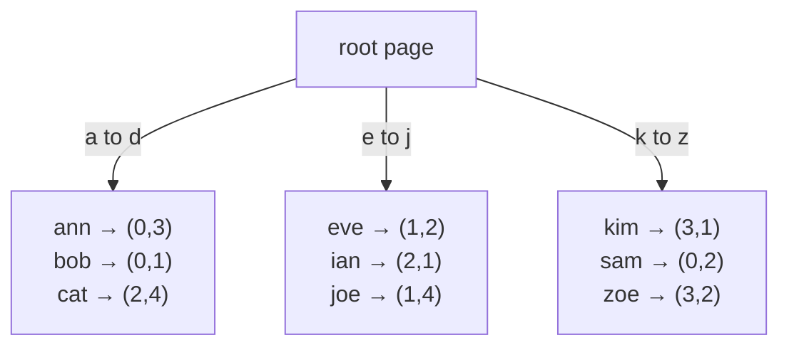

Without an index, finding one user by email means reading every page of the table and checking every row. That's a sequential scan. On a table of a few thousand rows it's fine. On a table of 100 million rows, it reads gigabytes to return one row.

An index is a second relation, next to the table, built so Postgres can find rows without reading all of them. In the architecture part I showed one as a sorted list of emails pointing to `(page,row)` positions. That's the idea, but a sorted list doesn't work once it's millions of entries long and changes all the time.

## Index types

Postgres has six kinds of index built in, each for a different kind of search.

- B-tree, the default, for equality and ranges on anything that can be sorted.
- Hash, for equality only.
- GiST, a general tree for things like geometry, ranges, and nearest neighbour.
- SP-GiST, for data that splits into non-overlapping parts, like IP addresses or points.
- GIN, an inverted index for values that contain many items, like arrays, `jsonb`, and full-text search.
- BRIN, a tiny summary of each block of pages, for huge tables where values follow the physical order, like timestamps.

Extensions can add more. `pgvector`, for example, adds indexes for vector search.

Most of your indexes are B-trees, so that's the one we'll open.

## B-tree

A B-tree is the sorted list from the architecture part, cut into pages, with a page on top that says where to look.

Take the index on `users.email`, with nine users.



The three pages at the bottom are the leaves. Together, they hold every email in order, each with the `ctid` of its row in the table.

The root page holds no rows. It only says which leaf covers which part of the alphabet.

To find `eve`, Postgres reads the root, sees that `eve` is between `e` and `j`, and reads the second leaf. There, `eve` points to `(1,2)`, so it reads page 1 of the table and takes row 2. That's two index pages and one table page, instead of the whole table.

Each leaf also points to the next one. For `WHERE email >= 'bob'`, Postgres finds `bob` in the first leaf, then just reads to the right, leaf after leaf, without going back to the root.

Here, a page holds three emails. A real 8 KB page holds a few hundred. Say 300. Then the root can point to 300 leaves, which is 90,000 emails with two levels. Add a level in between and it's 27 million, add another and it's 8 billion. So finding one row in a huge table means reading three or four index pages, and the top ones are read so often they're always in shared buffers.

## Page splits

When a new key has to go into a leaf that's full, Postgres splits it. It moves half of its keys to a new page, and adds a separator for the new page to the parent. If the parent is full too, it splits as well, up to the root. When the root splits, the tree gets one level taller.

That's why `CREATE INDEX` fills leaf pages to 90% only. The space left lets the first inserts land without a split.

A split happens while other backends are reading the tree. Postgres uses the Lehman and Yao design for this. Every page keeps a link to its right neighbour and a high key, the largest key it can hold. A reader that lands on a page right after a split sees that its key is above the high key, and follows the right link to the page that now holds it. Readers never have to lock the whole tree.

## Duplicates

An index on a column like `status` holds the same few values millions of times. Since Postgres 13, the B-tree stores a repeated key once, followed by the list of `ctid`s that have it. On columns with many duplicates, that makes the index much smaller.

## Visibility

An index entry has no `xmin` or `xmax`. It points to a row version and knows nothing about whether your transaction can see it.

So after finding a `ctid` in the index, Postgres still reads the table page to check the version against your snapshot. That's an index scan. It's a lookup in the index, then a lookup in the table, for every match.

That's also why an update, outside of HOT, adds an entry to every index. The old version and the new one both need to be findable until vacuum removes the old one. When a leaf is about to split because of these old entries, Postgres first tries to delete the ones pointing to dead versions, and often avoids the split.

## Scan types

The planner can use an index in three ways.

An index scan walks the index and reads the table row for each match, in index order. It's best when there are few matches, or when the query needs the rows sorted.

A bitmap scan first collects every matching `ctid` from the index, sorts them by page, then reads each table page once. It's best when there are many matches spread across the table, and it can combine several indexes with `AND` and `OR`.

An index-only scan skips the table entirely when the index has every column the query needs. It still has to know the row is visible, so it checks the visibility map. If the page is marked all-visible, it doesn't read it.

```sql
EXPLAIN (ANALYZE, COSTS OFF, TIMING OFF, BUFFERS OFF, SUMMARY OFF)
SELECT email FROM users WHERE email > 'm';
--  Index Only Scan using users_email_idx on users (actual rows=48210.00 loops=1)
--    Index Cond: (email > 'm'::text)
--    Heap Fetches: 0
--    Index Searches: 1
```

`Heap Fetches: 0` means every page was all-visible, so the table was never read. Right after a lot of writes, before vacuum runs, that number goes up, and the scan gets slower.

## Multicolumn indexes

An index on `(country, city)` is sorted by country first, then by city inside each country. It's fast for a query on `country`, or on `country` and `city`.

For a query on `city` alone, the cities are scattered across every country. Since Postgres 18, a B-tree can still use it with a skip scan. It jumps to each distinct country and searches for the city inside it. That works well when the first column has few distinct values, and badly when it has millions.

## The cost

Indexes aren't free. Every insert writes to every index of the table, and so does every update that isn't HOT. Each index takes space in shared buffers and on disk, and produces WAL.

So an index you don't use still costs you on every write. `pg_stat_user_indexes` shows how many times each index was scanned, and the ones stuck at zero are worth a look.
