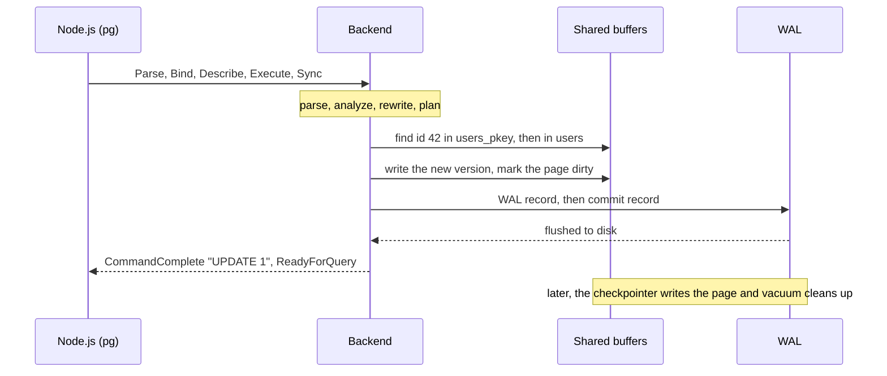

We've looked at each part of Postgres on its own. Now let's follow one query through all of them, from a line of JavaScript to a row on disk.

```js
await pool.query("UPDATE users SET name = $1 WHERE id = $2", ["Anna", 42]);
```

The table has a primary key on `id`, and no index on `name`.



## In the driver

`pool.query` takes an idle client from the pool, or opens a new connection if there are fewer than 10. A new connection means a TCP connection, a startup message, SCRAM authentication, and a new backend process forked by the postmaster. A pooled one skips all that, which is the point of the pool.

Since the query has parameters, `pg` uses the extended protocol. It sends five messages in one go: `Parse` with the SQL text, `Bind` with `'Anna'` and `42`, `Describe`, `Execute`, and `Sync`. The values travel separately from the SQL, so they can never be read as SQL.

## In the backend

The backend reads the messages from its socket. On `Parse`, the parser turns the text into a tree, and the analyzer looks up `users` in the catalog and checks that `name` and `id` exist. It also takes the first lock, `ROW EXCLUSIVE` on `users`, through the fast path, in the backend's own slots. Nothing else conflicts with it, unless someone is running a migration.

The rewriter has nothing to do, since `users` is a plain table with no rules or row security.

On `Bind`, the planner gets the values. With `id = 42` on a primary key, it expects one row, so it picks an index scan on `users_pkey` under an `Update` node.

## A transaction starts

There was no `BEGIN`, so Postgres started a transaction for this statement as soon as `Parse` arrived. It doesn't have a transaction ID yet, since it hasn't written anything. Before running, it takes a snapshot, which tells it which versions it can see.

## Finding the row

The executor starts at the top node, which asks the index scan for a row.

The index scan needs the root page of `users_pkey`. It asks the buffer manager, which hashes the page's tag, finds it in one of the 128 partitions of the buffer table, and pins it. The root is read so often it's always there. Same for the next level. The leaf page with `42` might be too, or it gets read from disk into a slot the clock sweep frees up.

The leaf says `42` is at `(7,3)`. The index scan reads page 7 of `users` the same way, follows line pointer 3, and checks the version against the snapshot. `xmin` committed long ago, `xmax` is zero. It's visible.

## Writing the new version

Now the transaction writes for the first time, so it gets a transaction ID, say 9120.

It sets `xmax` of the old version to 9120. That's also the row lock. Anyone else trying to update this row will now wait for transaction 9120 to end.

Then it writes the new version, with `name = 'Anna'` and `xmin` 9120. `name` isn't indexed and page 7 has room, so it's a HOT update. The new version goes on the same page, at `(7,5)`, and the old one points to it. No index is touched.

The page is now dirty in shared buffers. Nothing has been written to the table file.

## WAL

Before releasing the page, the backend writes a WAL record describing the change, a `HOT_UPDATE` on page 7. If this is the first change to page 7 since the last checkpoint, the record carries a full image of the page.

The record goes into the WAL buffers, and its LSN goes into page 7's header. From now on, page 7 can't be written to disk until the WAL is flushed up to that LSN.

## Commit

The `Update` node asks for another row, the index scan has none, and the executor is done. Since the statement was its own transaction, Postgres commits it right away.

It writes a commit record into the WAL buffers, then flushes the WAL up to it and waits for the disk. That's the only time this query waits for the disk to write anything. If other backends are committing too, one flush may cover several of them.

Then it marks 9120 as committed in `pg_xact`, removes itself from the list of running transactions, so new snapshots see the change, and releases its lock on `users`.

## Back to the client

The backend sends `CommandComplete` with the tag `UPDATE 1`, then `ReadyForQuery` with the status `I`, idle, outside a transaction. `pg` resolves the promise with `rowCount: 1`, and puts the client back in the pool.

Your `await` returns. A few milliseconds have passed.

## After

The query is done, but Postgres isn't.

- The walwriter, or the next commit, flushes whatever else is in the WAL buffers.
- If there's a standby, the walsender streams the new records to it, and its startup process applies the same change to its own page 7.
- At the next checkpoint, the checkpointer writes page 7 to the table file, unless the background writer did it first.
- The old version at `(7,3)` is dead once no snapshot needs it. The next time someone reads page 7 while it's nearly full, they prune it. Otherwise vacuum removes it, and the free space map learns that page 7 has room again.

One `UPDATE`, and it went through the client, the wire protocol, a process, the parser and planner, the buffer manager, MVCC, a row lock, the WAL, and later the checkpointer, a replica, and vacuum.

When I started, Postgres was a place where rows and columns live. Now, when I run an `UPDATE`, I see all of that happening underneath. I hope you do too.
